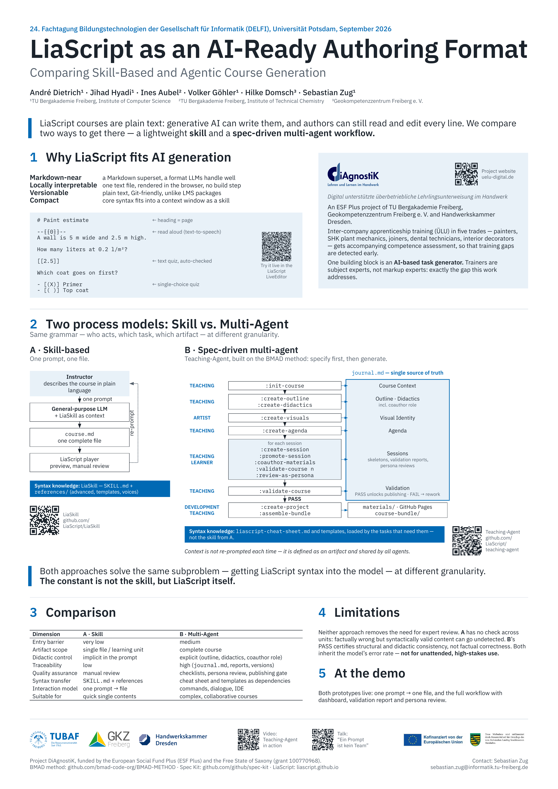

# LiaScript as an AI-Ready Authoring Format: Comparing Skill-Based and Agentic Course Generation

**Autor:innen:** André Dietrich, Jihad Hyadi, Ines Aubel, Volker Göhler, Hilke Domsch, Sebastian Zug

**Veranstaltung:** 24. Fachtagung Bildungstechnologien (DELFI 2026), Universität Potsdam, 15.–17.09.2026 — Postersession am 17.09.2026

[Poster als PDF](poster.pdf)

